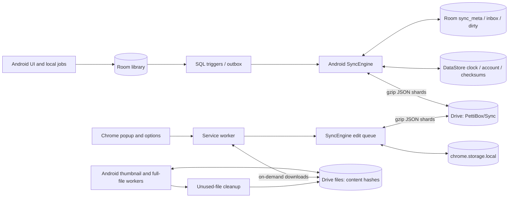

# PettiBox sync and system-design audit

**Date:** 2026-10-10 (America/Chicago)  
**Reviewed revision:** 2ebb9c9afe42f8297741f44362fc3384988d9c82  
**Scope:** Android metadata sync, Chrome extension, Google Drive layout, account/reset lifecycle, attachment transfer and cleanup, persistence, validation, and test coverage.

## Assessment

**The merge model has useful compatibility coverage, but the complete sync system cannot yet be described as correct under failure and concurrency.** The most serious gaps are outside the pure merge function: retry metadata writes, Android account ownership and clock persistence, deletion capture, reset fencing, and destructive folder reconciliation.

This audit identifies **12 primary findings** and **3 additional design/observability concerns**. Evidence is explicitly distinguished:

- **Reproduced:** executed production JavaScript modules/functions with isolated memory storage and fake Drive.
- **Source-confirmed:** the problematic branch/order is present; Android runtime execution was unavailable.
- **Design risk:** a concrete allowed interleaving violates an intended guarantee, but the full scenario was not executed.

**P1** means address before claiming reliable cross-device operation because of data loss, unintended disclosure, or serious integrity risk. **P2** means a reliability, recovery, or usability defect. These priorities reflect impact, not measured production frequency.

No product implementation or real user data was changed. The accompanying probes assert current defects; they are evidence scripts, not acceptance tests that should remain green after fixes.

## System as implemented

Each device holds the merged library and publishes up to 16 shards under its own device ID. Records use version vectors and concurrent field values, with observed-remove behavior for tags/files. Blob transfer is separate from metadata. There is no server coordinating writers, resets, folder moves, or cleanup, so those operations need explicit distributed-systems rules.

This is **eventual consistency**, not an atomic multi-device transaction. A round can commit local changes and upload several shards before a later upload fails. The comment at SyncEngine.kt:47 claiming failure leaves both sides unchanged overstates the implementation. Completed steps are retained and must be safe to retry.

## Findings at a glance

| ID | Priority | Area | Finding | Evidence |
|---|---|---|---|---|
| D01 | P1 | Chrome persistence | Retry bookkeeping can erase a new edit's upload intent | Reproduced |
| D02 | P1 | Android accounts | Backup account switching changes shared credentials without a sync ownership check | Source-confirmed; account-picker behavior needs device test |
| D03 | P1 | Android persistence | Clock is not committed atomically with records | Source-confirmed + model reproduction |
| D04 | P1 | Android apply | A permanent deletion during apply can be discarded | Source-confirmed |
| D05 | P1 | Reset | Reset does not fence uploads already in progress | Chrome reproduction; Android source trace |
| D06 | P1 | Drive folders | Consolidation can delete late uploads; duplicate attachment folders are hidden | Two reproductions |
| D07 | P1 | Android files | Two workers can modify the same partial download | Source-confirmed concurrency risk |
| D08 | P1 | Blob cleanup | Recent successful sync is not proof a blob remains unused | Design risk |
| D09 | P2 | Chrome network | Timeout ends at headers; stalled bodies can hold the edit queue | Reproduced |
| D10 | P1 | Validation | Invalid known-field types and causal metadata enter durable state | Reproduced |
| D11 | P2 | Recovery | Missing clean shards are not republished automatically | Chrome reproduction; Android source trace |
| D12 | P2 | Chrome review | Pending removal review blocks unrelated uploads | Reproduced |

## D01 — Retry bookkeeping bypasses the Chrome write queue

**Evidence:** [background.js:44](../extension/background.js#L44), [background.js:55](../extension/background.js#L55), [engine.js:95](../extension/sync/engine.js#L95). Probe D01.

The round releases the queue before scheduleRetry reads and rewrites the whole metadata object. An edit can run between that read and write. Retry persistence then overwrites the edit's new dirty set and clock with stale values. Multiple callers joining the same round also invoke retry bookkeeping separately.

**Observed:** the local title changed, its pending shard was erased, and a later successful round left the peer with the old title. The save remains local but silently fails to propagate.

**Fix:** serialize every metadata read-modify-write, including retry completion, through the engine queue. Prefer a dedicated engine method for retry state. Schedule once per completed round, not once per caller.

**Acceptance test:** pause retry persistence, commit an edit and rename, finish persistence, restart the worker, and prove both changes reach another device. Repeat with concurrent manual/alarm callers and sign-out.

## D02 — Android sync lacks account ownership isolation

**Evidence:** [SettingsViewModel.kt:416](../app/src/main/java/com/ghostgramlabs/pettibox/ui/screens/settings/SettingsViewModel.kt#L416), [DriveAuth.kt:33](../app/src/main/java/com/ghostgramlabs/pettibox/data/drive/DriveAuth.kt#L33), [SyncPorts.kt:52](../app/src/main/java/com/ghostgramlabs/pettibox/data/sync/SyncPorts.kt#L52), [SyncEngine.kt:104](../app/src/main/java/com/ghostgramlabs/pettibox/data/sync/SyncEngine.kt#L104), [FileSyncWorker.kt:58](../app/src/main/java/com/ghostgramlabs/pettibox/data/sync/FileSyncWorker.kt#L58).

The backup account picker and sync share DriveAuth. Sync opens the currently authorized account, reads and writes data, then stores its email at SyncEngine.kt:200. It never compares that identity against the account owning the retained library. The independent file worker also lacks that check. Upload-session URLs are keyed only by content hash in SyncPreferences.kt:228.

**Scenario:** enable sync under A; switch the backup account to B while sync remains enabled; edit a save. If Play Services subsequently supplies B's token as the wrapper intends, sync can merge B's records and upload A-derived records into B. Reset-marker differences may sometimes stop metadata sync but are not account isolation; file transfers use an independent path.

**Fix:** bind each library to a stable account identity and library ID. Scope caches, checksums, upload sessions, and transfer jobs accordingly. Pause both workers before switching; require explicit migration or separate account partitions. Validate ownership before all folder mutations and data I/O.

**Acceptance test:** use two actual Google test accounts. Switch through backup and sync screens with dirty records and an interrupted upload. Assert no A-to-B transfer without explicit migration. Live OAuth behavior was not exercised here.

## D03 — Android can persist a write but lose its logical clock

**Evidence:** [SyncEngine.kt:113](../app/src/main/java/com/ghostgramlabs/pettibox/data/sync/SyncEngine.kt#L113), [SyncEngine.kt:255](../app/src/main/java/com/ghostgramlabs/pettibox/data/sync/SyncEngine.kt#L255), [SyncEngine.kt:198](../app/src/main/java/com/ghostgramlabs/pettibox/data/sync/SyncEngine.kt#L198), [SyncEngine.kt:465](../app/src/main/java/com/ghostgramlabs/pettibox/data/sync/SyncEngine.kt#L465). Probe D03-model.

Room commits records and dirty flags before DataStore persists the clock. Process death or an upload exception can leave the clock behind durable records. The next commitLocal allocates dots from that stale clock without first observing the existing record's maximum timestamp. This matters with wall-clock rollback or previously observed remote time ahead of local time.

**Model reproduction:** a durable write at 100 followed by a restarted writer at 50 loses the title when merged with the peer's copy. This uses production JavaScript rules checked against Kotlin vectors, not an executed Android crash test.

**Fix:** persist the high-water mark in the same Room transaction as records, or reserve a durable monotonic range before emitting writes. No startup/local-write path may allocate a dot below an already emitted durable dot. Saving the clock only after successful upload is insufficient.

**Acceptance test:** inject death/failure after each record commit and before clock persistence; restart with a backward clock, edit the same field, and verify retention and convergence.

## D04 — Permanent deletion in Android's apply window is discarded

**Evidence:** [SyncEngine.kt:336](../app/src/main/java/com/ghostgramlabs/pettibox/data/sync/SyncEngine.kt#L336), [LocalLibrary.kt:85](../app/src/main/java/com/ghostgramlabs/pettibox/data/sync/LocalLibrary.kt#L85), [LocalLibrary.kt:221](../app/src/main/java/com/ghostgramlabs/pettibox/data/sync/LocalLibrary.kt#L221), [SyncModel.kt:355](../app/src/main/java/com/ghostgramlabs/pettibox/data/sync/SyncModel.kt#L355).

Late-edit reconciliation calls SyncDiff.apply only for a non-null local snapshot. Permanent deletion produces null. The branch still clears the outbox row and applies the incoming record. The model already supports a null local snapshot as a permanent-removal tombstone; this caller bypasses it.

**Scenario:** permanently delete an item after commitLocal while an incoming OCR/thumbnail-only change waits to apply. The deletion should stand under the user-versus-derived-write rule. Instead its event is cleared and applyItem can recreate it. Collection deletion has an analogous path. This is distinct from the intentional rule that a genuinely unseen user edit can revive a deletion.

**Fix:** pass null snapshots through diff and merge their tombstones; clear the outbox only after durably capturing the deletion.

**Acceptance test:** use the existing beforeApply hook to permanently delete a save while only a remote derived change arrives. Verify the record remains gone and propagates. Add the collection equivalent.

## D05 — Reset marker checks do not fence concurrent writers

**Evidence:** [engine.js:462](../extension/sync/engine.js#L462), [engine.js:575](../extension/sync/engine.js#L575), [SyncEngine.kt:125](../app/src/main/java/com/ghostgramlabs/pettibox/data/sync/SyncEngine.kt#L125), [DriveSyncClient.kt:330](../app/src/main/java/com/ghostgramlabs/pettibox/data/sync/DriveSyncClient.kt#L330), [FileSyncWorker.kt:58](../app/src/main/java/com/ghostgramlabs/pettibox/data/sync/FileSyncWorker.kt#L58). Probe D05.

Metadata sync checks the marker once, then may upload much later. A writer already past that check can create a shard after the reset's deletion list is processed. The Android file worker never checks the marker. Marker-first deletion therefore does not ensure every writer stops before uploading again.

**Observed:** a new shard was created after reset; the round reported success; only the next round stopped. The probe creates a previously absent shard, so it is a valid create rather than PATCH to a deleted file.

Reset can also partially fail after writing the marker or deleting some children, contradicting SettingsViewModel.kt:128's “nothing changed” failure description. Concurrent first resets can create two same-named markers; readers choose one rather than resolve a generation.

**Fix:** define a library generation/epoch in shard and blob namespaces. Readers accept only the active generation. Rechecking before uploads mitigates races but is not an atomic fence. Make reset resumable with visible partial-completion status, coordinate local cancellation across workers, and define cleanup of stale physical uploads.

**Acceptance test:** pause before each metadata/blob upload, reset elsewhere, release the writer, and prove old-generation data is never accepted. Repeat interrupted deletion and simultaneous resets.

## D06 — Folder reconciliation is destructive without excluding writers

**Evidence:** [DriveFolders.kt:96](../app/src/main/java/com/ghostgramlabs/pettibox/data/drive/DriveFolders.kt#L96), [drive.js:99](../extension/drive.js#L99), [DriveSyncClient.kt:55](../app/src/main/java/com/ghostgramlabs/pettibox/data/sync/DriveSyncClient.kt#L55), [drive.js:204](../extension/drive.js#L204). Probes D06a and D06b.

**A — Late-upload deletion:** consolidation lists children, moves that snapshot, and permanently deletes the source. A device caching the source ID can create a child between listing and deletion. That child is removed with the folder. This was reproduced in fake Drive; real Drive also deletes owned descendants with a folder. [Google Drive files.delete](https://developers.google.com/workspace/drive/api/reference/rest/v3/files/delete).

**B — Attachment-folder split:** merging root/Sync folders moves child files folders without recursively combining them. Both clients then use only the first files folder. Concurrent attachment-folder creation can produce the same split. An attachment placed in the second folder was invisible in the probe. Drive names are not unique identifiers. [Google Drive files resource](https://developers.google.com/workspace/drive/api/reference/rest/v3/files).

**Fix:** use stable namespace IDs and non-destructive migration aliases. Read all recognized legacy locations until writers transition. Do not permanently delete a folder based on one emptied snapshot. Discover/reconcile all attachment directories and invalidate stale cached IDs on 404/migration.

**Acceptance test:** concurrent creation, equal-time candidates, cached old writers, late child creation, and blobs split across folders. Assert complete discovery and no deletion of live children.

## D07 — Android workers share mutable partial-download files

**Evidence:** [FileSyncWorker.kt:94](../app/src/main/java/com/ghostgramlabs/pettibox/data/sync/FileSyncWorker.kt#L94), [FileSyncWorker.kt:167](../app/src/main/java/com/ghostgramlabs/pettibox/data/sync/FileSyncWorker.kt#L167), [DriveSyncClient.kt:262](../app/src/main/java/com/ghostgramlabs/pettibox/data/sync/DriveSyncClient.kt#L262).

Thumbnail and full-file workers have different unique work names, so both can execute together. Both download pending thumbnails. Each semaphore is local to its own worker, but downloadFile always uses the same <sha>.part path. No cross-worker per-hash lock exists.

**Risk:** one worker can truncate, append, rename, or delete the other's partial file. The digest is accumulated from each worker's incoming stream rather than an exclusive final disk read, so concurrent disk mutation also undermines the verification argument. Concurrent uploads can create duplicate files or competing resumable sessions.

**Fix:** coordinate transfers by account, epoch, and hash, with one active owner, atomic verified promotion, and exclusive partial-file ownership. Deduplicate upload discovery before creating sessions.

**Acceptance test:** run both workers on the same hash, interrupt/resume one, and verify exactly one valid promoted file and consistent session state. Not executed on Android here.

## D08 — Cleanup treats an old snapshot as current global knowledge

**Evidence:** [FileSyncWorker.kt:129](../app/src/main/java/com/ghostgramlabs/pettibox/data/sync/FileSyncWorker.kt#L129), [DriveFileCleanup.kt:51](../app/src/main/java/com/ghostgramlabs/pettibox/data/sync/DriveFileCleanup.kt#L51), [SyncEngine.kt:202](../app/src/main/java/com/ghostgramlabs/pettibox/data/sync/SyncEngine.kt#L202).

A metadata round up to six hours old permits permanent deletion of blobs previously observed unused for 30 days. Another device can restore/add a reference after that round but before deletion. Cleanup does not check whether remote shards still match its snapshot. Later failed rounds do not universally invalidate the previous clean timestamp. Repeated local observations are not proof of continuous global non-use.

**Impact:** currently referenced attachments can disappear. Repair requires a device with the physical bytes; a restored record containing only a placeholder cannot recreate them. The documented design allows some temporary missing-file behavior but cannot guarantee safe global reclamation.

**Fix:** prefer reversible quarantine. Tie candidates to account/epoch and a validated reference snapshot, revalidate before quarantine, and define offline-device leases/retirement and restore guarantees. Revalidation narrows the race but does not replace a distributed deletion protocol.

**Acceptance test:** age an unused candidate for 30 days, restore it elsewhere after the cleaner's last round, then clean. Include a restoring device with only a placeholder; require recoverability through the documented restore window.

## D09 — Chrome deadlines stop at headers, not body completion

**Evidence:** [drive.js:46](../extension/drive.js#L46), [drive.js:175](../extension/drive.js#L175), [engine.js:434](../extension/sync/engine.js#L434). Probe D09.

The abort timer is cleared when fetch returns headers. Callers consume JSON, bytes, text, or blobs afterward. A stalled body has no application deadline. Metadata sync holds the edit queue, so a slow read can delay local saves. A 120-second transfer timer also cannot guarantee MV3 worker survival; Chrome documents shutdown conditions including delayed fetch responses. [Chrome worker lifecycle](https://developer.chrome.com/docs/extensions/develop/concepts/service-workers/lifecycle).

**Observed:** with the deadline shortened to 5 ms, a stalled response body remained unaborted after 25 ms.

**Fix:** keep deadlines active through body consumption, checkpoint work, and consider network downloads outside the local-edit queue followed by a short revalidated merge/commit. Preserve intervening edits and test worker termination.

**Acceptance test:** delayed headers, stalled bodies, mid-body disconnects, and worker death. Local saves remain durable and sync resumes safely.

## D10 — Validation does not enforce merge or consumer invariants

**Evidence:** [codec.js:34](../extension/sync/codec.js#L34), [codec.js:114](../extension/sync/codec.js#L114), [SyncCodec.kt:44](../app/src/main/java/com/ghostgramlabs/pettibox/data/sync/SyncCodec.kt#L44), [SyncCodec.kt:167](../app/src/main/java/com/ghostgramlabs/pettibox/data/sync/SyncCodec.kt#L167). Probe D10.

Primitive values are accepted without the required types for known fields. Version vectors need not cover their heads/tag/file dots. The future-time check examines the vector, allowing an inconsistent vector to hide a future head. Shard range and filename/body/record placement are not enforced. Dot timestamps are truncated instead of strictly checked. Decompression and record counts are unbounded before materialization.

**Observed:** a numeric URL, shard 99, and a head timestamp beyond its vector were accepted and persisted. The round returned success; savedPage then threw because the URL was not a string.

**Fix:** validate known-field types, bounded finite safe integers shared by Kotlin/JS, nonnegative causal stamps, vector coverage, identifier/hash syntax, shard placement, and resource limits before persistence. Preserve unknown fields under a bounded schema. Quarantine corrupt local entries with diagnostics rather than silently omit them when republishing.

**Acceptance test:** malformed but valid JSON/gzip, inconsistent vectors, oversized decompression, conflicting duplicate records, unsafe integers, and field-type mismatches. Require whole-file rejection with unchanged local state.

## D11 — Disappearing clean shards are not healed

**Evidence:** [engine.js:479](../extension/sync/engine.js#L479), [engine.js:575](../extension/sync/engine.js#L575), [SyncEngine.kt:146](../app/src/main/java/com/ghostgramlabs/pettibox/data/sync/SyncEngine.kt#L146), [SyncEngine.kt:413](../app/src/main/java/com/ghostgramlabs/pettibox/data/sync/SyncEngine.kt#L413). Probe D11.

Both clients discover their remote files but upload only dirty shards. They do not compare locally required shards with those still in Drive. Replica removal or accidental deletion leaves them absent until that shard changes or sync is explicitly restarted.

**Observed:** deleting an owned shard without changing the reset marker was followed by a successful round sending zero files. The local copy survived, but a new device could not recover it from Drive.

**Fix:** after account/epoch validation, mark missing owned shards dirty. Distinguish replica repair from intentional retirement. Never let repair undo a global reset.

**Acceptance test:** remove one/all owned shards, sync without edits, and verify repair in the same epoch; verify no repair into a reset or retired generation.

## D12 — Chrome removal review blocks unrelated outgoing saves

**Evidence:** [engine.js:515](../extension/sync/engine.js#L515), contrasted with [SyncEngine.kt:185](../app/src/main/java/com/ghostgramlabs/pettibox/data/sync/SyncEngine.kt#L185). Probe D12.

Chrome returns before upload when incoming removals require review. Unrelated local saves remain queued until the user answers. Android explicitly uploads local dirty shards in that branch.

**Fix:** retain a durable review snapshot while continuing safe outbound local work. Bind the decision to the reviewed snapshot/generation rather than a global choice that may apply to a different set next round.

**Acceptance test:** during pending mass-removal review, an unrelated new save reaches peers while removals remain pending. New destructive changes arriving after the prompt require appropriate fresh review.

## Additional concerns

### O01 — “Synced” does not establish complete understanding or file availability (P2)

Probe O01 confirms Chrome silently ignores a newer-format shard and reports clean success. Android tracks unreadable shards to inhibit cleanup but can still report metadata success without an upgrade warning. FileSyncWorker.kt:58–72 can convert missing authorization or exhausted transfer retries into worker success without per-file user feedback.

Distinguish local saved, metadata uploaded, remote changes applied, files pending, unsupported protocol, and review pending. Upload success is not acknowledgement that a peer received the edit.

### O02 — Backup and post-apply side effects are not durable guarantees (P2)

[SyncPorts.kt:76](../app/src/main/java/com/ghostgramlabs/pettibox/data/sync/SyncPorts.kt#L76) catches/logs backup failure, after which SyncEngine.kt:117–120 marks first backup complete. There may be no safety backup before initial merge or mass-change apply. Return a typed outcome and define whether failure blocks or asks for an explicit proceed choice.

The inbox is cleared before afterApply schedules reminders/link work at SyncEngine.kt:360–364. Death between these steps can lose follow-up work unless another subsystem reconstructs it. Persist a side-effect outbox in the same transaction and drain it idempotently. This audit did not establish that all reminder/article startup paths repair every case; end-to-end impact needs validation.

### O03 — Scale, payload retention, and privacy need explicit contracts

Every device republishes full merged metadata through 16 fixed shards. Tombstones retain field contents; removing one replica does not remove those contents from others. There is no specified safe metadata compaction or maximum record/library size. Benchmark large libraries and many devices; define retirement, causal-summary compaction, and retention before promising a deletion SLA.

Locked collections are a presentation/access-control feature, not end-to-end encrypted sync. LocalLibrary snapshots their records and transport uploads gzip JSON; Chrome hides them after receiving the metadata. If locked data must never reach Chrome or Drive in readable form, encryption and key distribution require separate design. This is a trust-boundary clarification, not evidence that the product currently promises end-to-end encryption.

## Existing verification and previous improvements

The current extension suite passed **39/39 tests**, including 250 Kotlin merge vectors, 200 local-diff vectors, and 120 duplicate-fold vectors. It covers representative convergence, deletion/restoration, mass-removal review, signed-out gating, Chrome account mismatch, record/dirty persistence, sign-in UI feedback, and editor changed-field submission.

Earlier items such as missing retries, absent browser review/recovery, all-fields editor submission, and the literal “Manual only” label are now addressed. They are **not listed as still unfixed**. D01/D09 concern defects in newer retry/timeout implementations.

Passing merge-model and representative-flow tests does not establish atomic Room/DataStore persistence, safe destructive Drive operations, or correct concurrent workers.

## Validation and limits

| Check | Result |
|---|---|
| node --test test/*.test.js from extension/ | 39 passed, 0 failed |
| node audit/sync-design-probes.mjs from repository root | 10 scenarios reproduced; one is a model-only Android clock consequence |
| Android sync unit-test attempt | Could not start: wrapper needed Gradle 8.11.1 download; network permission denied even with --offline |
| Live Android/Chrome/Google OAuth/Drive | Not performed |
| Android findings | Source review; device/instrumentation reproduction required |
| Product code and real user data | Unchanged |

Evidence: [probe script](sync-design-probes.mjs), [captured results](sync-design-probe-results.json). These are isolated in-memory scenarios, not real OAuth/Drive. The reset transport models missing update targets as 404; its reproduction creates a new shard.

## Remediation order

1. **Stop silent lost edits and unintended account movement:** D01–D04. Add serialized/transactional ownership and failure-injection tests.
2. **Protect destructive operations:** D05–D08. Do not claim reset, permanent cleanup, and folder consolidation are fully safe until their acceptance tests pass.
3. **Bound failures and recover:** D09–D11. Strict validation, complete deadlines, generation-aware repair, and crash-resumable work.
4. **Complete user-facing guarantees:** D12, O01, O02. Safe outbound sync during review, partial/degraded status, durable side effects, verifiable backups.
5. **Document scale and retention:** O03. Realistic benchmarks and clear distinctions between sync, backup, retirement, and permanent deletion.

Target invariants: every successful local edit has durable upload intent; every emitted dot exceeds the writer's durable high-water mark; account and epoch govern all I/O; destructive operations do not trust an unprotected listing; malformed input cannot enter durable state; and status distinguishes saved, uploaded, received, and file-complete.

## Release verification matrix

| Scenario | Required result |
|---|---|
| Offline edits plus retry/settings/sign-out races | No edit or upload intent disappears |
| Death between persistence steps | Clock never regresses; values retained |
| Android backup account switch with sync enabled | No implicit transfer of the old account's library |
| Permanent delete during derived update | Delete captured and propagated |
| Reset during shard/blob upload | Old-generation writes excluded |
| Folder migration with cached writers | Complete discovery; no live subtree deleted |
| Two workers downloading one hash | One verified promotion; no shared partial-file collision |
| Restore just before blob cleanup | Referenced bytes remain recoverable |
| Stalled headers/body and Chrome worker death | Safe resume; truthful UI |
| Invalid/oversized/new-version shard | Whole-file rejection or explicit upgrade status |
| Owned shard removed without reset | Safe repair |
| Pending review plus unrelated local save | Safe local changes still reach peers |

This is a bounded audit of the stated revision, not proof that no other defects exist. Re-run probes and acceptance tests after changes and update the guarantees accordingly.

## Resolution — 2026-10-10

Every finding was addressed on `feature/device-sync`. Acceptance tests replace the probes: `extension/test/audit.test.js` (Chrome, 10 tests) and the `d0…`/`o02` tests in `TwoDeviceSyncTest` (Android, on an emulator), plus new `DriveFoldersTest` and `DriveResumableTest` cases. The original probe script now stops at its first assertion because the defect no longer reproduces.

| ID | Status | Change | Test |
|---|---|---|---|
| D01 | Fixed | Retry bookkeeping reads and writes metadata inside the engine queue; concurrent callers share one round and one bookkeeping pass. | audit.test.js D01 |
| D02 | Fixed | A library is bound to the account it first synced with; rounds and the file job do no I/O under another account and say why. Turning sync off ends the binding (explicit migration). | d02 |
| D03 | Fixed | A clock ceiling (max(now, clock) + writes + 60 s) is persisted before every Room write that emits dots; first-sync stamps are capped at now; keepShown saves before writing. | d03 |
| D04 | Fixed | Late-edit reconciliation passes a null snapshot through SyncDiff, so a permanent deletion becomes a tombstone that is merged in. | d04 |
| D05 | Fixed (fenced by epoch) | Shards carry the reset marker as `epoch`; readers skip other epochs; writers re-check the marker before every shard; the file job checks it before uploading; concurrent markers resolve to the smallest content; reset failure text no longer claims nothing changed. Stray blobs from a stale writer are reclaimed by cleanup. | audit.test.js D05, d05 ×2 |
| D06 | Fixed | Consolidation merges same-named sub-folders recursively, never deletes: an emptied duplicate is trashed only if a fresh listing is still empty. Cached folder ids are re-validated (not trashed) each round. Duplicate `files` folders are settled on both clients. | audit.test.js D06a/D06b, DriveFoldersTest |
| D07 | Fixed | Process-wide per-hash lock around every upload and download; a job that waited re-checks whether the placeholder is still pending or the file was just sent. | (concurrency by construction; resumable/partial tests in DriveResumableTest) |
| D08 | Mitigated | Cleanup trashes (30-day recoverable) instead of deleting; re-validates that no other device's shard changed since the clean round; requires empty inbox/outbox; any round start clears the clean flag; a device needing a missing hash restores it from trash. A full distributed deletion protocol (leases for long-offline devices) is not implemented; the residual window is documented in sync-spec. | DriveFileCleanupTest, code review |
| D09 | Fixed | The Chrome deadline covers body consumption (json/text/arrayBuffer/blob race the timer). | audit.test.js D09 |
| D10 | Fixed | Shared validation in both codecs: field types, safe non-negative integer stamps, vv coverage of every dot, shard range and file-name match, duplicate records, record and unpacked-size limits. | audit.test.js D10 ×2, vectors |
| D11 | Fixed | Owned shards holding records but absent from Drive are marked dirty (after the reset check). | audit.test.js D11, d11 |
| D12 | Fixed | Chrome uploads local work while a review is pending; on both clients a decision is bound to the reviewed set and a different set asks again. | audit.test.js D12, d12 |
| O01 | Fixed (metadata) | Newer-format shards produce a visible "another device uses a newer version" status on both clients. Per-file transfer status is still not surfaced. | audit.test.js O01 |
| O02 | Fixed | `safetyBackup()` returns success; first-sync backup is retried until it works; mass removal is not applied without one. Follow-ups are recorded before apply and re-run next round. | o02 |
| O03 | Documented | Retention, scale and the trust boundary are stated in sync-spec: locked collections are hidden in Chrome but synced to the user's Drive unencrypted; tombstones keep field values. | — |

Remaining known limits: no cross-device lease protocol for blob reclamation (D08); per-file transfer progress is not shown in the UI (O01); metadata compaction is not implemented (O03).
