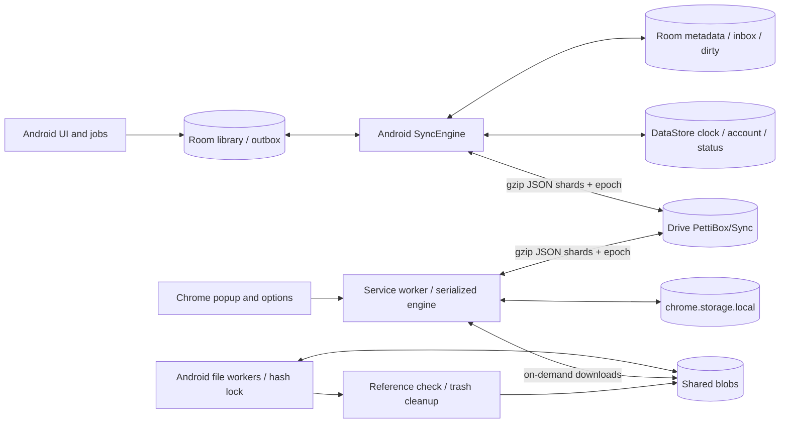

# PettiBox sync and system-design audit

**Rechecked:** 2026-10-10 (America/Chicago)

**Current reviewed revision:** 17b36760ee3fc2c66654e2c42308a77595567d5e

**Original audit revision:** 2ebb9c9afe42f8297741f44362fc3384988d9c82

**Scope:** Chrome sign-in feedback, metadata sync, Android persistence, accounts, reset, Drive folders, attachment transfers/cleanup, validation, and user-visible status.

## Current assessment

**Not all reported issues are fixed.** Of the 15 original findings, **6 are fixed for the reported failure**, **8 remain partially fixed or mitigated**, and **1 is documented with implementation work deferred**. The previous resolution appendix overstated closure; this recheck replaces it with the verified statuses below.

All **49 extension tests passed**, including sign-in UI tests and 10 added audit regressions. Three additional isolated probes demonstrate remaining reset-marker, attachment-discovery, and validation gaps. Android changes were inspected, but Android tests could not start because the Gradle wrapper required an unavailable download. No live OAuth, Chrome installation, Android device, or real Drive data was exercised.

“Fixed — tested” means the relevant automated JavaScript regression passed, not that every live-device failure mode was tested. “Fixed — source reviewed” means the reported branch is corrected, with Android runtime verification still pending. Partial findings remain open. P1/P2 are the original impact priorities, not measured production frequency.

## Status of every reported finding

| ID | Priority | Current status | Verification and remaining work |
|---|---|---|---|
| D01 | P1 | **Fixed — tested** | Retry bookkeeping uses the engine queue; one bookkeeping pass per shared round. |
| D02 | P1 | **Partially fixed — open** | Known account mismatch is blocked, but identity lookup failure permits sync; transfer state is not account/epoch scoped. |
| D03 | P1 | **Partially fixed — open** | A clock ceiling is saved first, but wall-clock-based allocation can exceed it after a delay or time jump. |
| D04 | P1 | **Fixed — source reviewed** | A null late local snapshot becomes a deletion tombstone; Android regression exists but was not run. |
| D05 | P1 | **Partially fixed — open** | Metadata epochs help; duplicate markers can conceal a later reset, and blob transfers lack complete fencing. |
| D06 | P1 | **Partially fixed — open** | Duplicate attachment folders merge; late children can still be stranded under a trashed folder. |
| D07 | P1 | **Fixed — source reviewed** | A process-wide per-hash lock prevents the reported simultaneous transfer collision. Android concurrency test still required. |
| D08 | P1 | **Mitigated — open** | Cleanup revalidates and trashes instead of permanently deleting; global reference and recovery guarantees remain incomplete. |
| D09 | P2 | **Fixed — tested** | Request deadline covers body consumption. Live MV3 termination/resume remains untested. |
| D10 | P1 | **Partially fixed — open** | Original malformed inputs are rejected; unsafe numeric field values and misplaced records still enter durable state. |
| D11 | P2 | **Fixed — tested in Chrome; Android source reviewed** | Missing owned shards are marked dirty and republished. Android test exists but was not run. |
| D12 | P2 | **Fixed — tested in Chrome; Android source reviewed** | Local saves upload during review; a changed removal-ID set requires another decision. |
| O01 | P2 | **Partially fixed — open** | Chrome upgrade warning works; Android clears its warning on success; per-file failure status remains absent. |
| O02 | P2 | **Partially fixed — open** | Backup outcome and mass-removal gate added; warning persistence and duplicate-fold follow-up durability still need work. |
| O03 | Design | **Documented; implementation deferred** | Privacy/retention and decoder limits are stated; compaction and measured capacity are not delivered. |

### Earlier sign-in UI report

**Fixed in the tested popup flow.** The suite confirms that sign-in refreshes the popup before slow sync finishes, sync/authentication errors appear, and sign-in can be retried. See the [popup regression tests](../extension/test/popup.test.js). This does not establish that the installed extension has been rebuilt/reloaded or that its real OAuth configuration is correct; neither was verified here.

## Current system

Sync remains eventually consistent. Each device publishes the merged library in up to 16 shards; blob transfer is separate. Completed steps survive a later failure. The Android engine's earlier misleading all-or-nothing comment has been corrected. There is no coordinator making account changes, folder migration, reset, and cleanup atomic across devices.

## Detailed recheck

### D01 — Retry bookkeeping: fixed

[background.js](../extension/background.js) now reads and updates retry metadata inside engine.exclusive. syncNow shares the round and its completion work. The D01 acceptance test pauses retry persistence while an edit is enqueued, then proves its dirty flag and peer-visible title survive. The original stale whole-metadata overwrite is corrected.

### D02 — Account ownership: partially fixed

The engine and file worker compare a known owner with the current email. However, [DriveSyncClient.kt:407](../app/src/main/java/com/ghostgramlabs/pettibox/data/sync/DriveSyncClient.kt#L407) catches account lookup failures and returns null. Both guards require a non-null account before rejecting a mismatch: [SyncEngine.kt:133](../app/src/main/java/com/ghostgramlabs/pettibox/data/sync/SyncEngine.kt#L133) and [FileSyncWorker.kt:66](../app/src/main/java/com/ghostgramlabs/pettibox/data/sync/FileSyncWorker.kt#L66).

**Remaining failure:** switch credentials from A to B, let the identity request fail transiently, then let later Drive calls succeed. The retained A library is allowed to continue using B's token. Also, [SyncPorts.kt:53](../app/src/main/java/com/ghostgramlabs/pettibox/data/sync/SyncPorts.kt#L53) resolves/mutates folders before the engine checks identity. Resumable sessions remain keyed only by hash, and resetForDisable does not clear them ([SyncPreferences.kt:228](../app/src/main/java/com/ghostgramlabs/pettibox/data/sync/SyncPreferences.kt#L228), [325](../app/src/main/java/com/ghostgramlabs/pettibox/data/sync/SyncPreferences.kt#L325)); the process-wide recently-sent cache also lacks account/epoch scope.

**Required:** fail closed when identity cannot be established, validate before folder mutations, and scope/reset transfer state and running jobs on account/generation transitions. Add null-identity and interrupted-transfer account-switch tests. The existing d02 Android test covers a successful lookup returning a different email only.

### D03 — Durable clock: partially fixed

[SyncEngine.kt:117](../app/src/main/java/com/ghostgramlabs/pettibox/data/sync/SyncEngine.kt#L117) now persists max(clock, wall time) + write count + 60 seconds before record-writing transactions. keepShown also persists its timestamp first. This addresses the ordinary crash window covered by the new d03 test.

**Remaining design gap:** [HybridClock.next](../app/src/main/java/com/ghostgramlabs/pettibox/data/sync/SyncModel.kt#L317) still uses current wall time without enforcing the reserved ceiling. A transaction wait, large-file hashing during snapshot, process suspension, or forward clock change can exceed the minute. A later Room commit followed by death before the final save can again leave a durable dot above the saved clock; restart with a backward clock recreates the original problem. The comment asserting writes never exceed a minute is not an enforced bound.

**Required:** use an enforced durable allocation range, reserve each candidate before emission, or persist the clock with records in Room. Test exceeding the reservation, then crash/restart with time rollback. This residual is source/design evidence, not an executed Android crash reproduction.

### D04 — Late permanent deletion: fixed in source

[SyncEngine.kt:404](../app/src/main/java/com/ghostgramlabs/pettibox/data/sync/SyncEngine.kt#L404) passes a null local snapshot to SyncDiff when a prior record exists, merges the tombstone, and clears the outbox in the transaction. The added d04 instrumentation test deletes an item during apply while a derived opened-time update arrives. The source corrects the reported defect; execute this test and the collection equivalent on Android before release.

### D05 — Reset: partially fixed

Shards now carry epochs, readers reject different epochs, and metadata writers check the marker before each shard. Chrome D05 tests pass. The file worker checks the marker at startup. Partial deletion failure text now acknowledges that some remote data may already be gone.

**Remaining gaps:**

- Both readers select the smallest marker content, while [resetEverything](../app/src/main/java/com/ghostgramlabs/pettibox/data/sync/DriveSyncClient.kt#L383) updates only the first matching marker. With two markers left by concurrent creation, later resets can keep the same effective epoch. The recheck probe demonstrates this using the production Chrome reader and a modeled Android write selection: marker contents 1/2 become 3/2 and then 4/2; readers see 2 for both resets. This is not an executed Android reset test.
- [FileSyncWorker.kt:70](../app/src/main/java/com/ghostgramlabs/pettibox/data/sync/FileSyncWorker.kt#L70) checks only before its batch. Upload/download/resume work can continue across a reset, and blob names/sessions lack an epoch namespace. The metadata fix does not establish blob fencing.
- Chrome's pending-review path ignores upload's negative reset result ([engine.js:544](../extension/sync/engine.js#L544)), reporting review instead of immediately recording reset/stopped state.

**Required:** give every reset an unambiguous advancing generation even with duplicate markers; fence blob jobs and sessions; handle the review-branch reset result. Test successive resets after duplicate creation, in-flight blob uploads, and interrupted reset recovery.

### D06 — Folder reconciliation: partially fixed

Recursive merging and settling duplicate files folders fix the original static split-folder reproduction. Permanent deletion has been replaced with trashing after a second empty listing. Chrome D06b passes, and Android DriveFolders has matching changes.

**Remaining reproduced failure:** a blob arrives after that final listing but before the duplicate files folder is trashed. It survives in the fake Drive store, but storedFiles cannot discover it in this or the next round. [drive.js:141](../extension/drive.js#L141) and [DriveFolders.kt:126](../app/src/main/java/com/ghostgramlabs/pettibox/data/drive/DriveFolders.kt#L126) still have a list-then-trash race. Android's restoreTrashed searches the canonical folder, not a retired sibling containing the late child.

The existing D06a test only asserts that bytes remain in the fake store; it does not establish discoverability or automatic recovery. **Required:** retain discoverable migration aliases or scan/drain retired locations until writers have transitioned. Assert late-child availability after migration, not merely physical survival.

### D07 — Shared partial-download collision: fixed in source

[DriveSyncClient.kt:60](../app/src/main/java/com/ghostgramlabs/pettibox/data/sync/DriveSyncClient.kt#L60) uses a companion-level per-hash mutex shared across client instances. [FileSyncWorker.kt:99](../app/src/main/java/com/ghostgramlabs/pettibox/data/sync/FileSyncWorker.kt#L99) and [122](../app/src/main/java/com/ghostgramlabs/pettibox/data/sync/FileSyncWorker.kt#L122) hold it across upload/download and placeholder promotion; waiting jobs recheck whether work is needed. This addresses the reported simultaneous thumbnail/full-worker collision in the app process.

Runtime verification remains: overlap both workers on the same hash with interruption/resume and verify the promoted bytes. Hash-only account/epoch cache concerns remain tracked under D02/D05 rather than being treated as resolved by this lock.

### D08 — Blob cleanup: mitigated

[FileSyncWorker.kt:151](../app/src/main/java/com/ghostgramlabs/pettibox/data/sync/FileSyncWorker.kt#L151) now requires empty inbox/outbox, checks remote checksums again, and trashes candidates. Each metadata round clears the previous clean flag. Android can restore a missing hash from trash in the canonical files folder.

This narrows the original stale-snapshot problem but is not a global deletion protocol: another writer can add a reference after revalidation; an offline device can return outside the documented recovery window. Chrome lists untrashed files only and cannot itself perform Android's restore path. A browser-only reader may remain unable to open a needed quarantined file.

**Required:** define and test a recovery window and offline-device policy, provide consistent restoration across clients, and add a placeholder-only restore racing cleanup test. Do not claim that a recent clean round proves permanent global non-use.

### D09 — Response-body timeout: fixed

[drive.js:52](../extension/drive.js#L52) keeps the deadline through json/text/arrayBuffer/blob consumption and races it against body reads. The stalled-body regression passes. This closes the reported timer-cleared-at-headers defect. Network operations still hold the engine queue, and real Chrome service-worker termination/restart remains a release test rather than a verified guarantee.

### D10 — Input validation: partially fixed

Both codecs now enforce known-field types, safe nonnegative causal stamps, dot coverage by the version vector, shard range, duplicate record rejection, and record/decompression limits. Engines compare filename device/shard with the envelope. Both D10 Chrome regressions and the shared vector tests pass; the original numeric URL, invalid shard range, and out-of-vector head cases are corrected.

**Remaining reproduced failure:** a shard envelope and filename can agree while the contained record hashes to a different shard. An unsafe integer reminder value is also accepted by [codec.js:119](../extension/sync/codec.js#L119) and [142](../extension/sync/codec.js#L142). The recheck feeds both into the production engine: it reports success with zero damaged files and persists the record. Android's known numeric fields likewise require Long type, without the shared safe-integer bound used for causal stamps ([SyncCodec.kt:87](../app/src/main/java/com/ghostgramlabs/pettibox/data/sync/SyncCodec.kt#L87)).

**Required:** validate each record's shard placement and consumer-specific numeric ranges before persistence, consistently across Kotlin/JS. Add whole-file rejection tests for these cases. The new checks are substantial but do not satisfy the original complete validation acceptance criteria.

### D11 — Missing own shards: fixed

[engine.js:513](../extension/sync/engine.js#L513) and [SyncEngine.kt:220](../app/src/main/java/com/ghostgramlabs/pettibox/data/sync/SyncEngine.kt#L220) mark locally held shards missing from Drive dirty. The Chrome test deletes the remote files, syncs without another edit, and confirms a fresh peer receives the data. An Android d11 test exists but was not run. Reset-protocol gaps are tracked separately in D05.

### D12 — Outgoing saves during review: fixed

[engine.js:537](../extension/sync/engine.js#L537) uploads local dirty records while retaining incoming removals for review. Decisions on both platforms are tied to the sorted removal-ID set. The Chrome test confirms an unrelated save uploads and additional removals require another review. Android has a corresponding changed-set test.

This binding covers the reviewed IDs, not a full content/version snapshot. If product requirements require renewed consent when destructive content changes for the same IDs, add version/generation binding. The demonstrated outgoing-upload blockage and changed-ID-set decision reuse are corrected. Reset status in this branch remains D05.

### O01 — Truthful sync/file status: partially fixed

The Chrome newer-format warning passes its regression test. Android records a warning at [SyncEngine.kt:253](../app/src/main/java/com/ghostgramlabs/pettibox/data/sync/SyncEngine.kt#L253), then returns Ok with damaged = 0. [round:71](../app/src/main/java/com/ghostgramlabs/pettibox/data/sync/SyncEngine.kt#L71) calls recordSuccess(keepError = false), and [SyncPreferences.kt:174](../app/src/main/java/com/ghostgramlabs/pettibox/data/sync/SyncPreferences.kt#L174) clears it. Thus the claimed persistent Android upgrade warning is not fixed when only newer-format files were skipped.

The file worker still returns success for missing authorization or exhausted transfer retries without per-file user feedback ([FileSyncWorker.kt:59](../app/src/main/java/com/ghostgramlabs/pettibox/data/sync/FileSyncWorker.kt#L59)). **Required:** preserve degraded metadata outcomes through final status, distinguish metadata completion from file availability, and test the final persisted UI state.

### O02 — Backup and follow-up durability: partially fixed

safetyBackup now returns success, firstBackupDone is set only on success, and failed safety backup blocks mass-removal apply. A durable pending-follow-up list is saved before applyInbox and replayed on the next round. These are substantive fixes.

Two gaps remain. First, backup error messages recorded within the round are erased by recordSuccess for Ok/NeedsReview outcomes, leaving the user without the failure reason. Second, [foldDuplicates](../app/src/main/java/com/ghostgramlabs/pettibox/data/sync/SyncEngine.kt#L444) still commits Room changes before afterApply without saving pending follow-ups. Death in that gap can lose reminder/link scheduling or cancellation. The new o02 test checks the backup gate, not status retention or crash recovery of follow-ups.

**Required:** preserve the backup warning, journal follow-ups for every apply path, and test death after duplicate-fold commit plus replay after restart. Initial sync is explicitly allowed to continue when the first backup fails; this is a product policy, not a guarantee that a pre-sync copy exists.

### O03 — Scale, retention and privacy: documented, not implemented

[sync-spec/README.md](../sync-spec/README.md) now states the privacy boundary and payload retention: locked collections are hidden in Chrome but synced in readable gzip JSON, and tombstones retain field values. Decoder record/unpacked-size limits are also documented. Safe metadata compaction and measured supported-library capacity remain absent. Supported scale, device retirement, and deletion/retention guarantees still need explicit contracts and benchmarks. This is documentation progress, not an encryption or compaction fix.

## Verification performed in this recheck

| Check | Result |
|---|---|
| node --test extension/test/*.test.js | **49 passed, 0 failed**; includes sign-in UI, 10 audit regressions, 250 merge vectors, 200 diff vectors, 120 folding vectors. |
| node audit/sync-design-recheck.mjs | **3 residual scenarios demonstrated**: marker generation unchanged, late blob undiscoverable, invalid placement/unsafe numeric value persisted. |
| gradlew.bat testDebugUnitTest --offline --console=plain | **Did not start tests.** Wrapper attempted Gradle 8.11.1 download; network failed with Permission denied. --offline cannot supply the missing wrapper distribution. |
| Android instrumentation tests | **Not run.** Added test source was inspected; no emulator execution is claimed. |
| Real Chrome/OAuth/Drive and Android devices | **Not performed.** Installed build behavior remains unverified. |
| Product code / user data | **Unchanged by this recheck.** Only audit documentation and isolated evidence artifacts were added/updated. |

Reproducible current evidence: [residual probe](sync-design-recheck.mjs) and [captured results](sync-design-recheck-results.json). The D05 probe models Android's marker-write choice; D06/D10 execute production JavaScript against isolated fake services. These probes assert remaining defects and must change when fixes land; green probe execution is not a clean bill of health.

The [original probes](sync-design-probes.mjs) and [original results](sync-design-probe-results.json) describe the earlier revision. Do not rerun them as if they were acceptance tests for this revision or use their historical results as current failures.

## Remaining release priorities

1. Close account-lookup failure and account/epoch transfer-state gaps (D02).
2. Remove the timing assumption from durable clock allocation (D03).
3. Correct repeated-reset generation selection and fence blob work (D05).
4. Preserve automatic discovery during folder migration and define cleanup recovery (D06/D08).
5. Complete record placement/numeric validation and persist truthful warnings/follow-up work (D10/O01/O02).
6. Execute Android instrumentation and live cross-device tests: account switching, process death, reset during uploads, dual file workers, offline restoration, and Chrome sign-in/reload.

This is a bounded recheck of the stated revision. It establishes specific fixes and remaining defects, not a guarantee that every sync path is issue-free.

## Developer changes after this recheck — awaiting re-verification

*Added by the developer, not by the reviewer. These are claims for the next recheck to verify; the statuses above are unchanged.*

| ID | Change | Evidence the developer ran |
|---|---|---|
| D02 | Account lookup failure now throws and the round/file job retry later (fail closed); the sync folder is resolved lazily, only after the identity check, on both clients; Chrome's file path checks the owner too; upload sessions and files status are cleared on turn-off; the recently-sent cache is keyed by files folder. | `recheck_d02_…` (emulator), `recheck D02` (node) |
| D03 | `HybridClock.ceiling` is enforced: past the saved ceiling stamps only count up, and exhausting the reserved range throws instead of exceeding it. | `ClockCeilingTest` (3) |
| D05 | `resetEverything` writes the new content to every marker; the file job re-checks the marker every 30 s during uploads; Chrome's review branch handles a reset found during upload. | `DriveResumableTest.a_reset_updates_every_marker…`, `recheck D05` (node) |
| D06 | A retired folder is labelled (`appProperties.pettiboxMergedInto`); every settle drains such folders' non-explicitly-trashed children back into the live folder; trashed-file restore searches anywhere and moves the file into the files folder. | `recheck D06` (node), `DriveFoldersTest` "moved back" |
| D08 | Chrome can take a trashed file back out (`restoreFile`), as Android does; the recovery window (30 + 30 days) and offline-device limit are stated in sync-spec. | `recheck D08` (node) |
| D10 | Engines reject a file containing a record outside its shard; field numbers must be safe integers in both codecs. | `recheck D10` (node) |
| O01 | Warnings recorded during a round persist through its success; photo/file problems (no authorization, retries exhausted) are recorded and shown in Settings. | `recheck_o01_…` (emulator) |
| O02 | Duplicate-fold follow-ups are journaled before commit and cleared after. | `recheck_o02_…` (emulator, warning retention) |
| O03 | Measured scale table and recovery window added to sync-spec; compaction still not implemented. | — |

Runs on 2026-10-10: extension 55/55; Android unit tests all passing; Android instrumentation 43/43 on the Pixel 5 API 36 emulator; headless Chrome smoke clean. `audit/sync-design-recheck.mjs` now stops at its D06 assertion (the late blob is discoverable); its D05 block models the old single-marker write rather than executing Android code, so it still passes by construction. Not performed: live two-account OAuth, real Drive reset, process-death injection on a device.
